# Entity Relationship Diagram (ERD) — MineTrack

Dokumentasi relasi antar entitas dan arsitektur database PostgreSQL untuk sistem monitoring operasional pertambangan **MineTrack**.

```mermaid
erDiagram
    USERS ||--o{ USER_SITE_ACCESS : has
    USERS ||--o{ SHIFT_ASSIGNMENTS : assigned_as_operator
    USERS ||--o{ SHIFT_ASSIGNMENTS : assigned_as_supervisor
    USERS ||--o{ PRODUCTION_RECORDS : records
    USERS ||--o{ PRODUCTION_RECORDS : reviews
    USERS ||--o{ PRODUCTION_STATUS_HISTORY : acted_by
    USERS ||--o{ DOWNTIME_REPORTS : reports
    USERS ||--o{ SAFETY_INCIDENTS : reports
    USERS ||--o{ SAFETY_FOLLOW_UPS : action_by
    USERS ||--o{ NOTIFICATIONS : receives
    USERS ||--o{ AUDIT_LOGS : performs

    SITES ||--o{ USER_SITE_ACCESS : grants
    SITES ||--o{ PITS : contains
    SITES ||--o{ WORK_BLOCKS : contains
    SITES ||--o{ EQUIPMENT : hosts
    SITES ||--o{ PRODUCTION_TARGETS : sets
    SITES ||--o{ PRODUCTION_RECORDS : occurs_at
    SITES ||--o{ DAILY_OPERATIONAL_REPORTS : logged_for
    SITES ||--o{ SAFETY_INCIDENTS : occurs_at

    PITS ||--o{ WORK_BLOCKS : divides
    PITS ||--o{ PRODUCTION_RECORDS : excavated_from

    WORK_BLOCKS ||--o{ PRODUCTION_RECORDS : block_source

    MATERIALS ||--o{ PRODUCTION_TARGETS : targeted
    MATERIALS ||--o{ PRODUCTION_RECORDS : mined

    SHIFTS ||--o{ SHIFT_ASSIGNMENTS : scheduled
    SHIFTS ||--o{ PRODUCTION_TARGETS : shift_target
    SHIFTS ||--o{ PRODUCTION_RECORDS : shift_mined
    SHIFTS ||--o{ DAILY_OPERATIONAL_REPORTS : shift_summary

    EQUIPMENT ||--o{ SHIFT_ASSIGNMENTS : allocated
    EQUIPMENT ||--o{ PRODUCTION_RECORDS : loaded_by
    EQUIPMENT ||--o{ DOWNTIME_REPORTS : undergoes_downtime
    EQUIPMENT ||--o{ MAINTENANCE_RECORDS : serviced
    EQUIPMENT ||--o{ PREVENTIVE_MAINTENANCE : serviced_under
    EQUIPMENT ||--o{ WEIGHBRIDGE_TICKETS : weighed

    SITES ||--o{ WEIGHBRIDGE_TICKETS : issues
    SITES ||--o{ PRODUCTION_RECONCILIATIONS : reconciled_for
    SITES ||--o{ OPERATIONAL_ALERTS : triggered_at
    SITES ||--o{ DOCUMENT_STORAGE : stores

    USERS ||--o{ WEIGHBRIDGE_TICKETS : weighed_by
    USERS ||--o{ DOCUMENT_STORAGE : uploads
    USERS ||--o{ PRODUCTION_RECONCILIATIONS : resolved_by
    USERS ||--o{ OPERATIONAL_ALERTS : resolved_by

    PRODUCTION_RECORDS ||--o{ PRODUCTION_STATUS_HISTORY : logs_transitions
    SAFETY_INCIDENTS ||--o{ SAFETY_FOLLOW_UPS : resolved_by
```

---

## Deskripsi Tabel & Skema Relasional

### 1. `users` & `user_site_access`
- **Tujuan**: Mengelola identitas pengguna, role (ADMINISTRATOR, SUPERVISOR, OPERATOR, MANAGEMENT), profil, status keaktifan, dan izin site.
- **Relasi**:
  - Many-to-Many ke `sites` melalui `user_site_access`.
  - One-to-Many ke `production_records` (sebagai pencatat atau pereview).
  - One-to-Many ke `shift_assignments`, `notifications`, dan `audit_logs`.

### 2. `sites`, `pits`, `work_blocks`
- **Tujuan**: Hirarki lokasi penambangan fisik (Site Tambang -> Pit / Front Tambang -> Blok Kerja).
- **Integritas**: Dilindungi dari penghapusan jika masih terdapat transaksi aktif (foreign key constraint & cascade rules terkelola).

### 3. `materials`
- **Tujuan**: Master jenis komoditas galian (Batubara/Coal, Overburden/OB, Nikel/Nickel, Bauksit/Bauxite).
- **Satuan**: Disimpan beserta kode dan satuan baku (`Ton`, `BCM`).

### 4. `shifts` & `shift_assignments`
- **Tujuan**: Manajemen shift kerja operasional (Day Shift, Night Shift) dengan dukungan lintas hari (cross-midnight).
- **Aturan Unik & Deteksi Bentrok**:
  - Operator tidak dapat ditugaskan ke shift yang bentrok pada tanggal yang sama.
  - Alat berat tidak dapat dialokasikan ke dua penugasan pada jam shift yang sama.

### 5. `equipment`, `downtime_reports`, `maintenance_records`
- **Tujuan**: Pemantauan armada alat berat (Excavator, Hauler/Dump Truck, Bulldozer, Wheel Loader).
- **Status Mesin**: `AVAILABLE`, `IN_USE`, `MAINTENANCE`, `BREAKDOWN`, `INACTIVE`.
- **Integrasi Siklus Hidup**:
  - Pembuatan laporan downtime otomatis mengubah status alat menjadi `BREAKDOWN` atau `MAINTENANCE`.
  - Penyelesaian laporan downtime otomatis mengembalikan unit ke status `AVAILABLE`.

### 6. `production_records` & `production_status_history`
- **Tujuan**: Inti pencatatan ritase dan timbangan operasional pertambangan.
- **Validasi Presisi**:
  - Kolom numerik presisi: `gross_weight`, `tare_weight`, `net_weight`.
  - Rumus bisnis timbang: `net_weight = gross_weight - tare_weight`.
  - Ditolak jika `gross_weight < tare_weight` atau bernilai negatif.
- **Riwayat Status (Audit)**: Setiap transisi status (`DRAFT` -> `SUBMITTED` -> `UNDER_REVIEW` -> `APPROVED` / `NEEDS_REVISION` / `REJECTED`) dicatat pada `production_status_history`.

### 7. `daily_operational_reports` (LOH)
- **Tujuan**: Laporan Operasional Harian komprehensif per site dan shift, mencakup rekapitulasi produksi resmi yang disetujui, durasi downtime, kondisi cuaca, kendala lapangan, dan rencana tindak lanjut.

### 8. `safety_incidents` & `safety_follow_ups`
- **Tujuan**: Pengawasan K3 pertambangan (Insiden, Near Miss, Kondisi Tidak Aman, Tindakan Tidak Aman).
- **Tingkat Keparahan**: `LOW`, `MEDIUM`, `HIGH`, `CRITICAL`.
- **Status Tindak Lanjut**: `OPEN` -> `UNDER_INVESTIGATION` -> `ACTION_REQUIRED` -> `RESOLVED` -> `CLOSED`.

### 9. `notifications` & `audit_logs`
- **Tujuan**:
  - Notifikasi in-app tersimpan di database dan diarahkan tepat ke pengguna terkait (pengajuan review, revisi laporan, downtime, insiden keselamatan).
  - Audit log mencatat jejak digital keamanan (login, perubahan data master, transaksi produksi, persetujuan, penetapan role) tanpa menyimpan password atau secret key.

### 10. `weighbridge_tickets`
- **Tujuan**: Pencatatan jembatan timbang digital (Gross, Tare, Net) secara presisi dengan format nomor tiket otomatis `WB-YYYYMMDD-XXXX`.
- **Integritas & Audit**:
  - Validasi berat `grossWeight > tareWeight` dan `netWeight = grossWeight - tareWeight`.
  - Pelat nomor armada dan nama supir tervalidasi.
  - Perubahan data timbang dicatat dalam `correctionHistory` JSON array (nilai lama, nilai baru, timestamp, user, alasan).
  - Pembatalan tiket memerlukan alasan wajib (`cancellationReason`) dan status `CANCELLED`.

### 11. `document_storage`
- **Tujuan**: Metadata berkas tersimpan aman untuk foto tiket timbang, bukti insiden K3, formulir inspeksi, dan dokumen operasional.
- **Keamanan**:
  - Pembatasan ukuran maksimum 10MB dan whitelist MIME type (JPEG, PNG, WEBP, PDF).
  - Penamaan berkas acak UUID (`crypto.randomUUID()`) mencegah path traversal dan penimpaan berkas.
  - Akses unduh/tinjau melalui HMAC-SHA256 Signed URL dengan masa kedaluwarsa (misal 2 jam).
  - Mekanisme rollback menghapus berkas fisik jika pencatatan metadata database gagal.

### 12. `production_reconciliations`
- **Tujuan**: Rekonsiliasi akuntansi produksi antara estimasi ritase lapangan (`production_records`) dan timbangan jembatan timbang aktual (`weighbridge_tickets`).
- **Analisis Selisih (Variance)**:
  - Deteksi selisih berat (`weightDiscrepancy`), selisih ritase (`ritaseDiscrepancy`), dan persentase deviasi (`variancePercentage`).
  - Ambang batas otomatis: Jika deviasi > 5%, status diset `VARIANCE_DETECTED`.
  - Supervisor dapat melakukan verifikasi dan penutupan selisih (`resolveReconciliation`) dengan catatan resolusi formal.

### 13. `preventive_maintenances`
- **Tujuan**: Penjadwalan pemeliharaan preventif armada berdasarkan jam operasi (Hour Meter / HM) atau interval tanggal.
- **Konsistensi Multi-Factor**:
  - Unit alat berat dilarang keras diubah statusnya menjadi `AVAILABLE` jika memiliki jadwal PM aktif berstatus `SCHEDULED` atau `IN_PROGRESS`.
  - Menyimpan checklist komponen (Oli mesin, Filter oli, Hidrolik, Undercarriage/Ban, Sistem rem, Kelistrikan) dan riwayat penggantian suku cadang.

### 14. `operational_alerts`
- **Tujuan**: Engine peringatan operasional otomatis mendeteksi bahaya dan penyimpangan proses lapangan.
- **Jenis & Deduplikasi**:
  - Tipe peringatan: `SAFETY_INCIDENT`, `EQUIPMENT_DOWNTIME`, `PRODUCTION_DEFICIT`, `WEATHER_HAZARD`.
  - `dedupKey` deterministik (misal: `DOWNTIME-[equipmentId]-[date]`) mencegah spam peringatan saat dashboard direfresh.
  - Status resolusi (`isResolved`), waktu penyelesaian, dan identitas user yang menyelesaikan.
