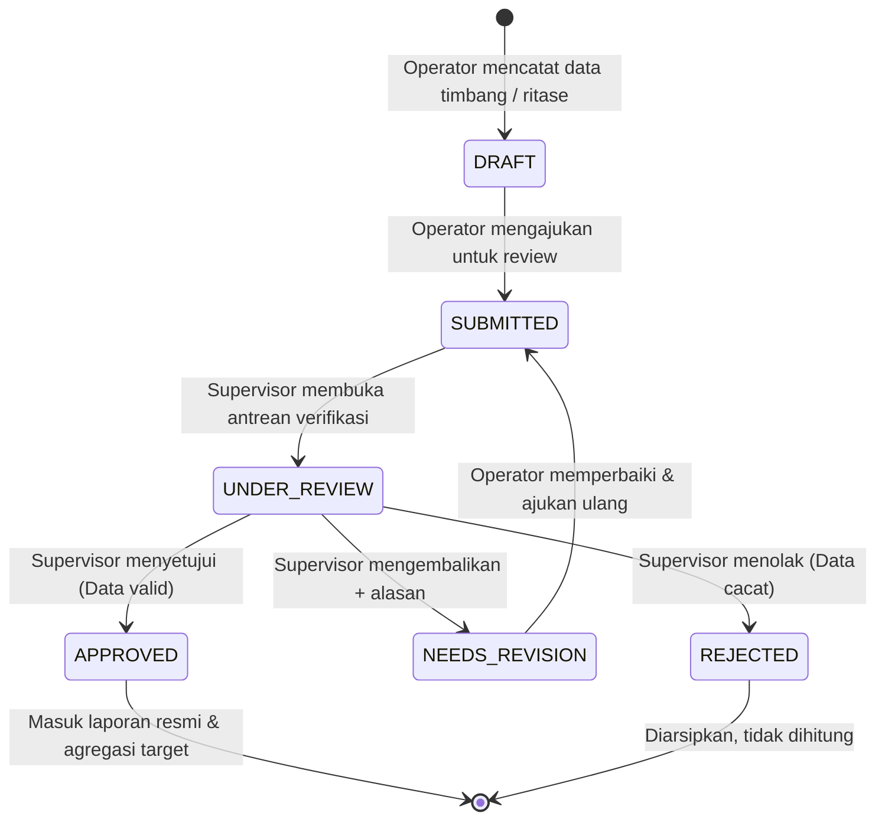
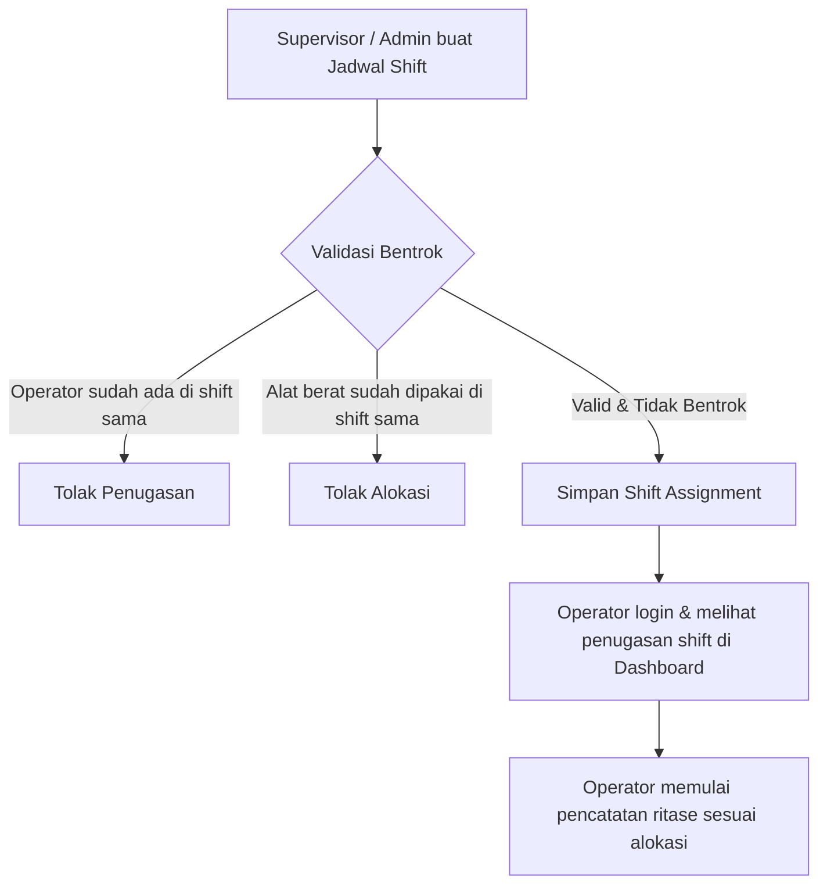
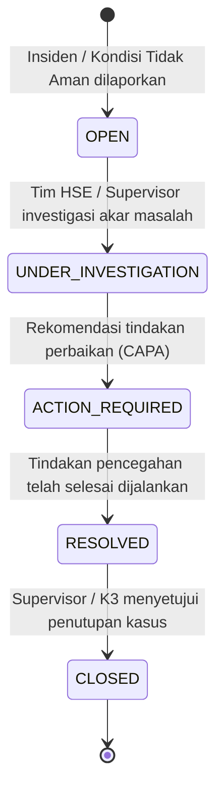
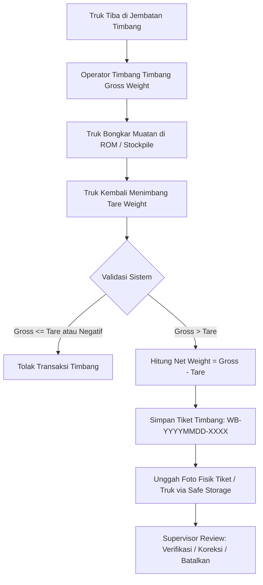
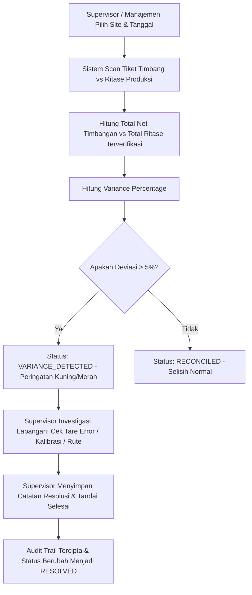
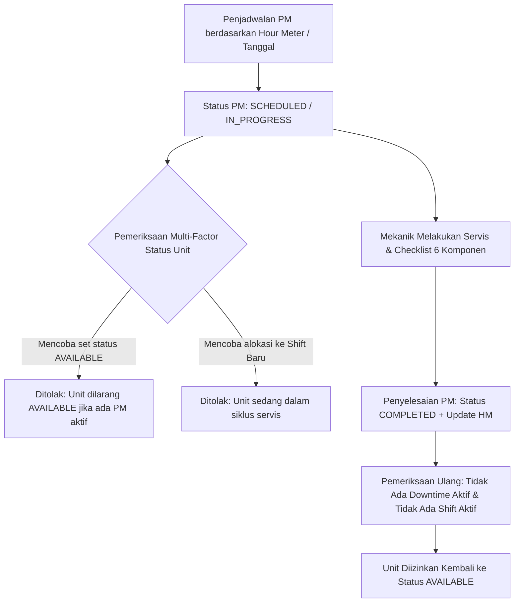
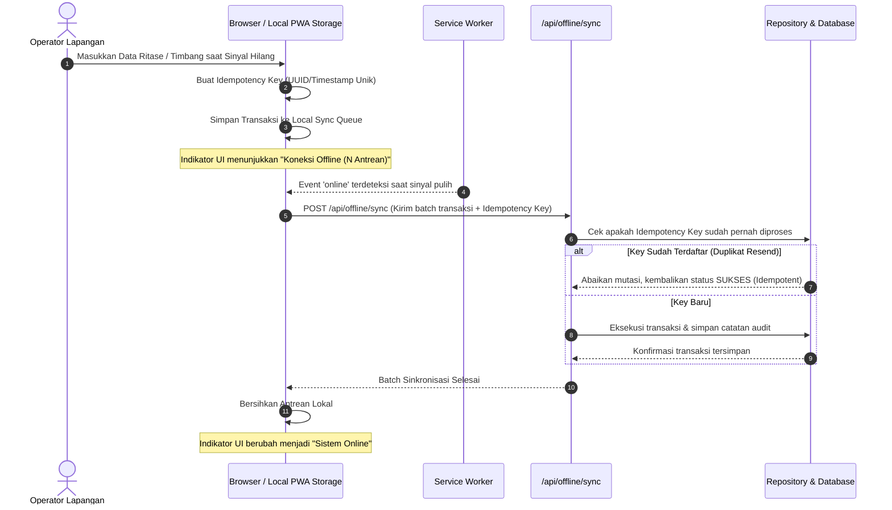

# Workflow Operasional & Persetujuan — MineTrack

Dokumentasi alur bisnis, siklus persetujuan, dan keterhubungan role di dalam sistem **MineTrack**.

---

## 1. Alur Persetujuan Catatan Produksi (Production Approval Workflow)



### Aturan Bisnis & Validasi Server:
1. **Pemisahan Data Resmi vs Draft**:
   - Hanya catatan dengan status `APPROVED` yang dihitung ke dalam analitik produksi resmi, grafik realisasi target, dan LOH (Laporan Operasional Harian).
   - Catatan berstatus `DRAFT`, `SUBMITTED`, atau `NEEDS_REVISION` dipisahkan secara tegas dan tidak mencemari angka produksi aktual.
2. **Kewenangan Operator**:
   - Operator hanya dapat mengedit catatan miliknya sendiri yang masih berstatus `DRAFT` atau `NEEDS_REVISION`.
   - Operator tidak dapat mengubah catatan yang sudah disetujui (`APPROVED`) atau catatan milik operator lain.
3. **Kewenangan Supervisor**:
   - Supervisor dapat menyetujui (`APPROVE`), menolak (`REJECT`), atau meminta perbaikan (`NEEDS_REVISION`).
   - Saat meminta perbaikan atau menolak, wajib mencantumkan catatan alasan perbaikan untuk memandu operator.
4. **Audit Trail**:
   - Setiap perubahan status dicatat secara atomik ke tabel `production_status_history` dan `audit_logs` dengan identitas user pembuat, status sebelumnya, status baru, alasan, dan stempel waktu.
   - Notifikasi otomatis dikirimkan ke kotak masuk in-app operator terkait.

---

## 2. Alur Pengelolaan Shift & Penugasan Armada



### Pencegahan Konflik (Conflict Detection):
- Validasi mencegah operator ganda pada tanggal dan shift yang sama.
- Validasi mencegah satu unit alat berat yang sama ditugaskan ke lebih dari satu operator pada shift yang sama.
- Mendukung jam kerja shift malam yang melintasi tengah malam (misal 20:00 - 05:00 WIB).

---

## 3. Alur Pelaporan Downtime & Siklus Pemeliharaan Alat

```mermaid
flowchart TD
    A[Gangguan Unit di Pit] --> B[Operator / Petugas lapor Downtime]
    B --> C[Status Alat Berat otomatis menjadi BREAKDOWN]
    C --> D[Notifikasi ke Supervisor & Tim Maintenance]
    D --> E[Penanganan Perbaikan & Penggantian Suku Cadang]
    E --> F[Supervisor / Teknisi tandai Selesai (Resolve)]
    F --> G[Durasi downtime dihitung dalam menit]
    G --> H[Status Alat Berat otomatis kembali AVAILABLE]
    H --> I[Downtime terakumulasi di Dashboard Management & LOH]
```

---

## 4. Alur Manajemen Keselamatan Kerja (K3)



- Insiden berstatus `CRITICAL` atau `HIGH` otomatis memicu peringatan prioritas tinggi di Dashboard Administrator, Supervisor, dan Management.
- Statistik keselamatan kerja (Zero Fatality, Total Kejadian, Status Penanganan) terhubung langsung ke Executive Dashboard Management.

---

## 5. Alur Jembatan Timbang Digital (Digital Weighbridge Lifecycle)



### Validasi & Audit Trail Timbangan:
1. **Pencegahan Fraud & Koreksi**: Setiap perbaikan nilai gross/tare sesudah tiket dibuat wajib mengisi alasan koreksi dan tercatat permanen di `correctionHistory`.
2. **Pembatalan Tiket**: Pembatalan tiket jembatan timbang hanya dapat dilakukan dengan mengisi `cancellationReason` wajib dan dicatat dalam audit log.

---

## 6. Alur Rekonsiliasi Produksi & Resolusi Discrepancy



---

## 7. Alur Pemeliharaan Preventif & Penegakan Multi-Factor Availability



---

## 8. Alur Sinkronisasi Offline PWA & Validasi Idempotensi


